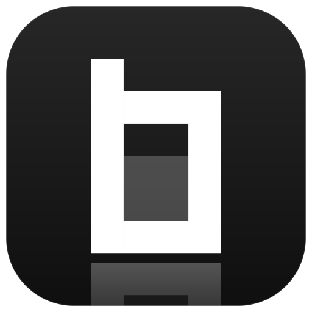
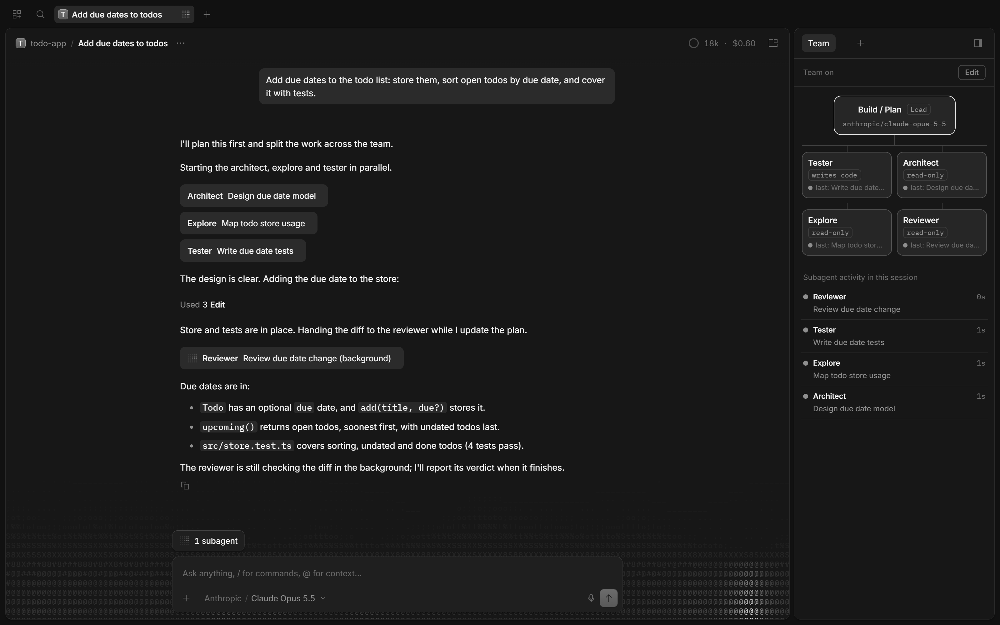
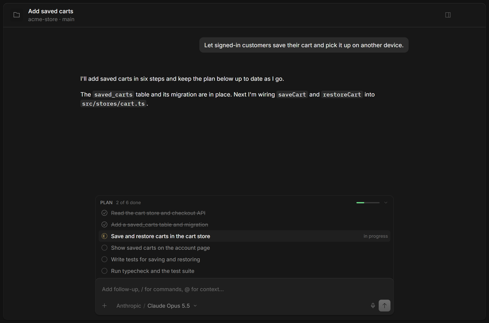
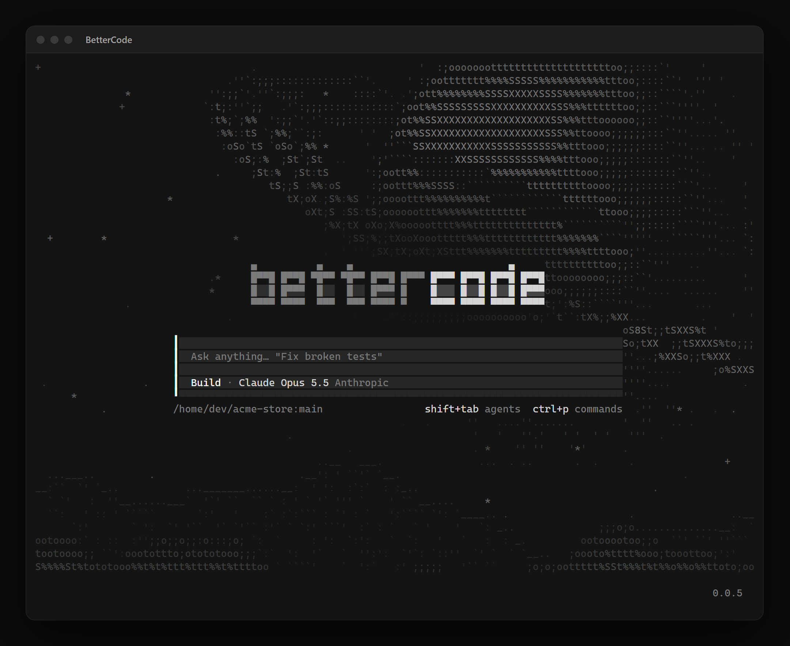
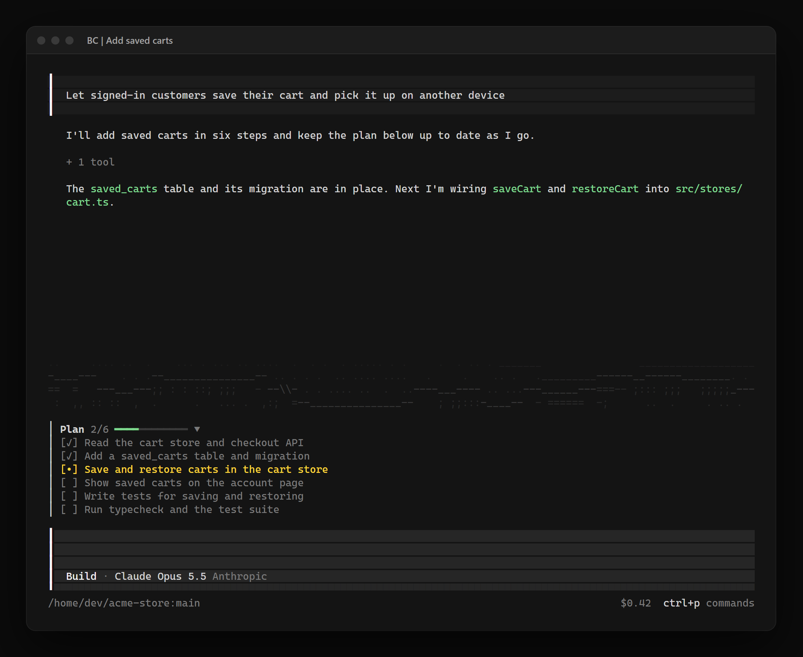
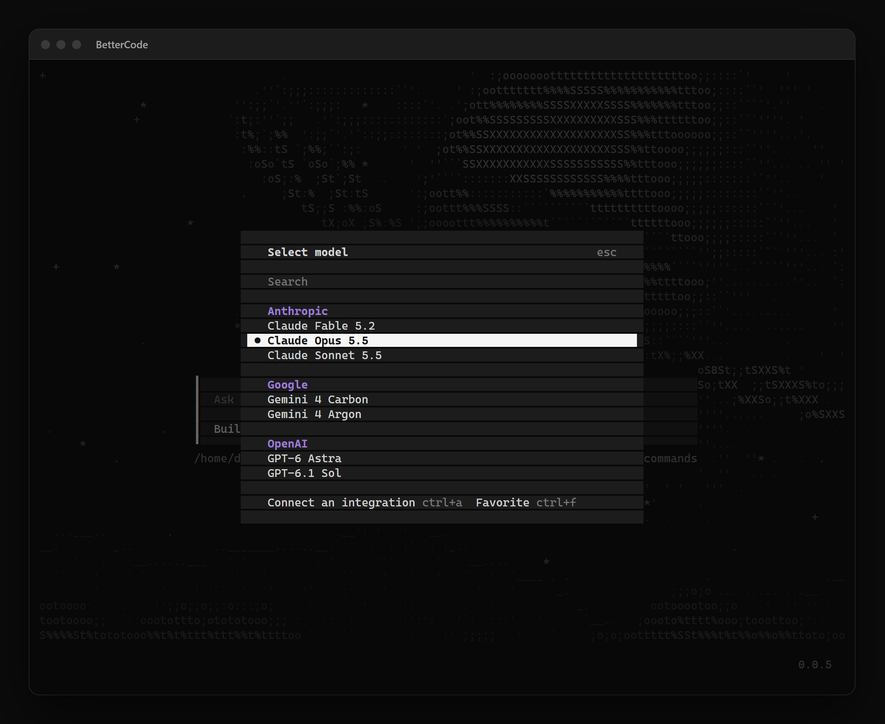

# BetterCode

An AI coding agent for your terminal and desktop, with a team of agents that plan and build together.

<br clear="left">

[](https://github.com/7q9k/BetterCode/releases/latest)
[](LICENSE)
[](#installation)



## Installation

One command installs the `bettercode` command and the desktop app. Run it again to update.

**macOS and Linux**

```bash
curl -fsSL https://github.com/7q9k/BetterCode/releases/latest/download/install | bash
```

**Windows (PowerShell)**

```powershell
irm https://github.com/7q9k/BetterCode/releases/latest/download/install.ps1 | iex
```

Then start it in any project:

```bash
cd my-project
bettercode
```

<details>
<summary>Installer options</summary>

| Option | bash | PowerShell |
| --- | --- | --- |
| Only the `bettercode` command, no desktop app | `\| bash -s -- --no-desktop` | `$env:BETTERCODE_NO_DESKTOP = "1"` |
| A specific version | `\| bash -s -- --version 0.0.1` | `$env:BETTERCODE_VERSION = "0.0.1"` |

The command goes to `~/.bettercode/bin`. The desktop app is built for macOS, Windows x64 and Linux x64. `bettercode upgrade` updates the command on its own.

Every release also lists the single files (command archives, macOS app bundles, Windows installer, `.AppImage`, `.deb`, `.rpm`) on the [releases page](https://github.com/7q9k/BetterCode/releases/latest).

</details>

## Features

- **Agent team.** The lead plans and hands work to specialists: architect, explore, tester, reviewer, debugger and more. The Team tab shows who is on the team, what each agent is doing and what it did last.
- **Plans you can see.** Before it starts, the agent writes its plan as a checklist pinned above the prompt, in the desktop app and the terminal, and ticks off each step as it goes. Bigger plans render as task graphs in the timeline and in a Plans tab; `/dag` runs wider graphs with lighter checks.
- **Every model.** Pick any model your providers offer, from Claude Opus 5.5 and Fable 5.2 to free models.
- **Live dictation.** Speak into the composer. Speech is transcribed locally with Whisper while you talk, segment by segment.
- **Terminal, desktop and web.** The same sessions in the terminal UI, the desktop app and the browser, with the same animated ASCII scene and monochrome look everywhere.
- **Browser control.** Agents drive the in-app browser by element or by screen coordinates, so any model that reads screenshots can move the pointer, click and drag.

<table>
  <tr>
    <td width="50%"></td>
    <td width="50%"></td>
  </tr>
  <tr>
    <td align="center">Desktop start screen</td>
    <td align="center">The plan, ticked off as the agent works</td>
  </tr>
  <tr>
    <td width="50%"></td>
    <td width="50%"></td>
  </tr>
  <tr>
    <td align="center">Terminal start screen</td>
    <td align="center">The same plan in the terminal</td>
  </tr>
  <tr>
    <td width="50%"></td>
    <td width="50%"></td>
  </tr>
  <tr>
    <td align="center">Model picker</td>
    <td align="center">Every model, in the terminal too</td>
  </tr>
</table>

## Next to OpenCode

BetterCode keeps its own configuration, sessions and background service (`~/.config/bettercode`, `~/.local/share/bettercode`), so it runs beside an installed OpenCode without touching it.

## Releasing

Run the **bettercode-release** workflow (Actions, bettercode-release, Run workflow) with a version such as `0.0.1`. It builds the command for every platform and the desktop app, and publishes them with both installers as the GitHub release `v0.0.1`.

## License

BetterCode is based on [OpenCode](https://github.com/anomalyco/opencode) and released under the same [MIT license](LICENSE). It is not built by the OpenCode team and is not affiliated with them in any way.
