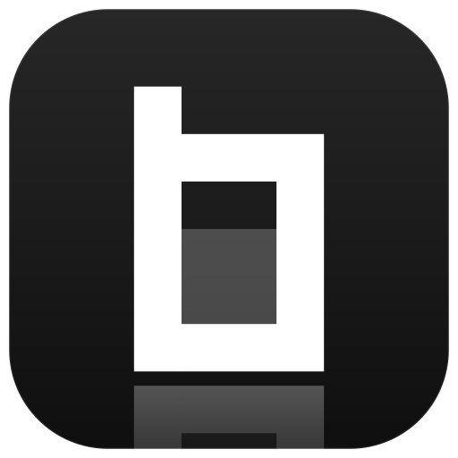
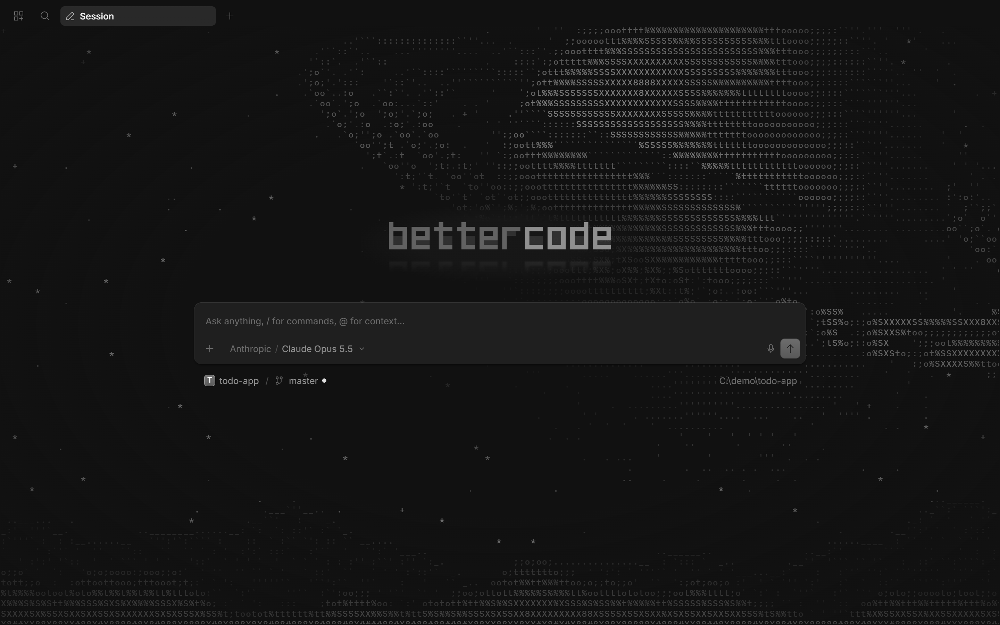
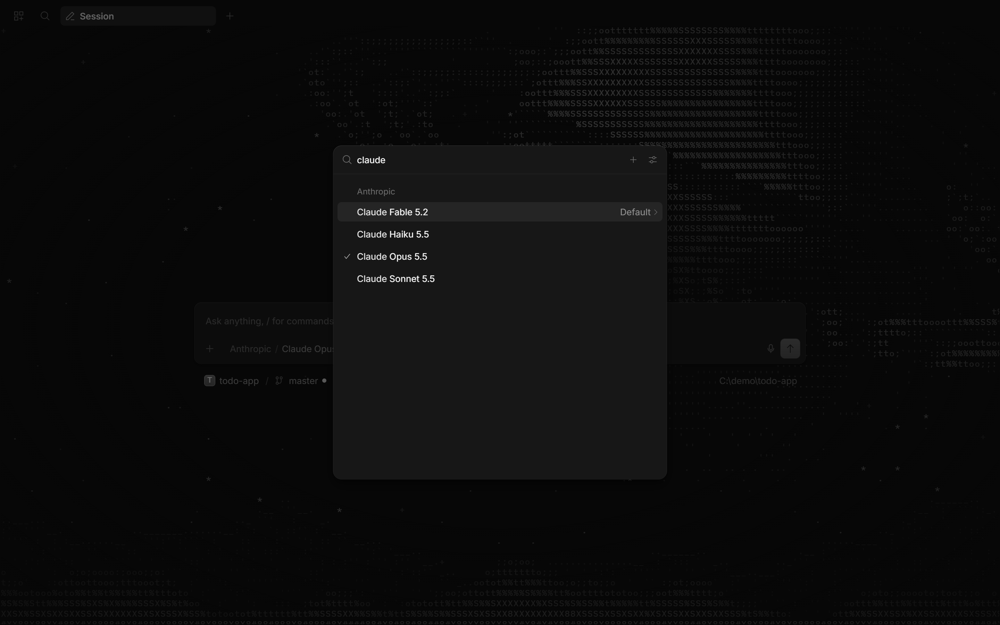

<p align="center">
  
</p>
<p align="center">An AI coding agent for your terminal and desktop, with a team of agents that plan and build together.</p>
<p align="center">
  <a href="https://github.com/7q9k/BetterCode/releases/latest"></a>
  <a href="LICENSE"></a>
</p>



---

### Installation

**macOS and Linux**

```bash
curl -fsSL https://github.com/7q9k/BetterCode/releases/latest/download/install | bash
```

**Windows (PowerShell)**

```powershell
irm https://github.com/7q9k/BetterCode/releases/latest/download/install.ps1 | iex
```

One command installs the `bettercode` command into `~/.bettercode/bin` and the BetterCode desktop app (macOS, Windows x64, Linux x64). Run it again to update; `bettercode upgrade` updates the command as well.

Then start it in any project:

```bash
cd my-project
bettercode
```

| Option | bash | PowerShell |
| --- | --- | --- |
| Only the `bettercode` command, no desktop app | `\| bash -s -- --no-desktop` | `$env:BETTERCODE_NO_DESKTOP = "1"` |
| A specific version | `\| bash -s -- --version 0.0.1` | `$env:BETTERCODE_VERSION = "0.0.1"` |

Every release also lists the single files (command archives, macOS app bundles, Windows installer, `.AppImage`, `.deb`, `.rpm`) on the [releases page](https://github.com/7q9k/BetterCode/releases/latest).

### What BetterCode adds

- **Agent team** – a Team tab that shows each agent as it starts, with an edit view for the team.
- **Plans you can see** – richer plans with plan views and a graph of the plan's steps; `/dag` runs wider graphs with lighter checks.
- **Every model** – pick any model your providers offer, from Claude Opus 5.5 and Fable 5.2 to free models.
- **Live dictation** – speak into the composer; speech is transcribed locally with Whisper while you talk, segment by segment.
- **A new look** – an animated ASCII start screen and the BetterCode identity across terminal, desktop and web.



### Side by side with OpenCode

BetterCode keeps its own configuration, sessions and background service (`~/.config/bettercode`, `~/.local/share/bettercode`), so it runs next to an installed OpenCode without touching it.

### Releases

Maintainers publish a release by running the **bettercode-release** workflow (Actions → bettercode-release → Run workflow) with a version such as `0.0.1`. It builds the command for every platform and the desktop app, and publishes them with both installers as the GitHub release `v0.0.1`.

---

BetterCode is based on [OpenCode](https://github.com/anomalyco/opencode) and released under the same [MIT license](LICENSE). It is not built by the OpenCode team and is not affiliated with them in any way.
